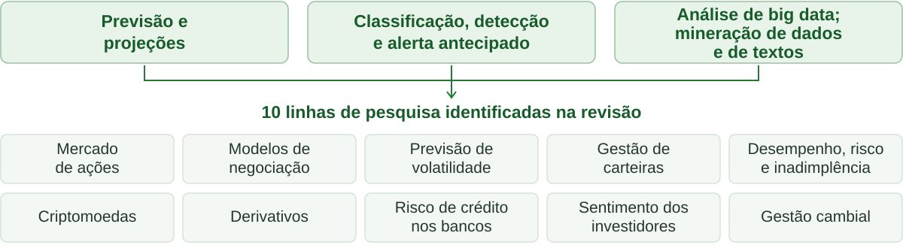

## Bacharelado em Administração {.opening-slide}

::: {.subtitle}
Disciplina: Tópicos especiais em Finanças

:::
Professor: Lelis Pedro de Andrade

::: {.kicker}
Inteligência Artificial e aplicações em Finanças
:::

::: {.opening-date}

:::

## Introdução {.work-impact-slide}

::: {.kicker}
IA, economia e trabalho · Impactos socioeconômicos
:::

::: {.economic-context}
A IA pode afetar organizações, economia e sociedade. A PwC (2017) projetou um PIB mundial até 14% maior em 2030 com a IA, frente ao cenário sem sua adoção.
:::

::: {.grid3 .impact-cards}

::: {.card .impact-up}
<svg class="impact-icon" viewBox="0 0 24 24" fill="none" stroke="currentColor" stroke-width="2" stroke-linecap="round" stroke-linejoin="round" aria-hidden="true"><path d="m3 17 6-6 4 4 8-10"/><path d="M15 5h6v6"/></svg>

<h3>Maior demanda</h3>

Expectativa de aumento para trabalhadores de alta qualificação.
:::

::: {.card .impact-down}
<svg class="impact-icon" viewBox="0 0 24 24" fill="none" stroke="currentColor" stroke-width="2" stroke-linecap="round" stroke-linejoin="round" aria-hidden="true"><path d="m3 7 6 6 4-4 8 10"/><path d="M15 19h6v-6"/></svg>

<h3>Menor demanda</h3>

Ocupações de baixa qualificação expostas à automação.
:::

::: {.card .impact-new}
<svg class="impact-icon" viewBox="0 0 24 24" fill="none" stroke="currentColor" stroke-width="2" stroke-linecap="round" stroke-linejoin="round" aria-hidden="true"><rect x="3" y="7" width="18" height="14" rx="2"/><path d="M8 7V4a1 1 0 0 1 1-1h6a1 1 0 0 1 1 1v3M3 16h18M11 12h2"/></svg>

<h3>Novas oportunidades</h3>

Criação de empregos que poderá compensar as perdas.
:::

:::

::: {.question}
A criação de novos empregos será suficiente para
compensar os postos substituídos pela IA?
:::

::: {.source}
Fontes: [Bahoo et al. (2024), Introdução, pp. 2–3](https://link.springer.com/content/pdf/10.1007/s43546-023-00618-x.pdf#page=2); [PwC (2017), Sizing the prize](https://www.pwc.ch/en/publications/2017/pwc_global_ai_study_2017_en.pdf). Projeções e expectativas, não resultados garantidos.
:::

::: {.notes}
Explicar os três efeitos esperados da IA
sobre o mercado de trabalho.

O destaque econômico retoma Bahoo et al., pp. 2–3, e a projeção histórica da PwC publicada em 2017. O percentual compara o nível do PIB mundial em 2030 com um cenário sem os efeitos da IA; não é uma taxa anual de crescimento nem um resultado já observado. O relatório original da PwC foi consultado para esclarecer esse sentido.

Destacar que a compensação das perdas de
empregos é uma expectativa, não uma certeza.

Discutir a necessidade de requalificação
dos trabalhadores.
:::

## Por que a IA ganhou espaço?

::: {.kicker}
01 · Contextualização · Bahoo et al. (2024)
:::

::: {.lead}
A IA é frequentemente tratada como tecnologia de uso geral.
:::

::: {.grid3}
::: {.card}
<h3>Dados</h3>
Disponibilidade de grandes bases, inclusive não estruturadas.
:::
::: {.card}
<h3>Computação</h3>
Expansão da capacidade de processamento.
:::
::: {.card}
<h3>Investimento</h3>
Capital de risco para projetos tecnológicos.
:::
:::

::: {.question}
O que essa combinação pode mudar na forma de analisar informações financeiras?
:::

::: {.source}
Paráfrase de [Bahoo et al. (2024), Introdução, p. 2](https://link.springer.com/content/pdf/10.1007/s43546-023-00618-x.pdf#page=2): tecnologia de uso geral e fatores de difusão.
:::

::: {.notes}
Slide 2 · 3 min. Apresentar os três fatores (1 min) e ouvir a turma sobre a pergunta (2 min). As respostas dos estudantes são hipóteses para discussão, não resultados empresariais. Localização: página 2, primeiro parágrafo e parágrafo sobre os fatores de desenvolvimento e difusão. As referências citadas pelos autores nesses trechos são Bresnahan e Trajtenberg (1995) e Ernst et al. (2018); a leitura usada nesta aula é a revisão de Bahoo et al., não uma consulta independente desses trabalhos. Mapa dos trechos em contextualizacao_fontes.md.
:::

## Por que estudar IA em Finanças?

::: {.kicker}
01 · Contextualização · Bahoo et al. (2024)
:::

::: {.lead}
Instituições financeiras dependem de dados e automação.
:::

::: {.grid3}
::: {.card}
<h3>Crédito e risco</h3>
Análise de crédito e previsão de falência.
:::
::: {.card}
<h3>Investimentos</h3>
Gestão de carteiras e negociação algorítmica.
:::
::: {.card}
<h3>Controle</h3>
Detecção de fraudes e conformidade regulatória.
:::
:::

::: {.question}
Que evidências precisamos para avaliar o uso de IA nessas decisões?
:::

::: {.source}
Aplicações e limites da literatura: [Bahoo et al. (2024), Introdução, p. 3](https://link.springer.com/content/pdf/10.1007/s43546-023-00618-x.pdf#page=3). Riscos: [Aldasoro et al. (2024), p. 2](https://www.bis.org/publications/working-paper-1194-intelligent-financial-system-how-ai-transforming-finance.pdf#page=5).
:::

::: {.notes}
Slide 3 · 3 min. Percorrer as aplicações listadas pelos autores (1 min) e discutir a pergunta (2 min). Os três cartões organizam aplicações expressamente mencionadas na introdução; não são uma taxonomia atribuída ao artigo. Ler a página 3 do extrato e distinguir a lista de usos de uma avaliação de eficácia. A coleta da revisão vai até março de 2021 (resumo e metodologia, pp. 1 e 5). Não usar a data de publicação de 2024 como se fosse a data final dos estudos examinados. O trecho complementar sobre riscos está na página impressa 2 do artigo do BIS, correspondente à página 5 do PDF integral. Mapa dos trechos em contextualizacao_fontes.md.
:::

## IA nas decisões financeiras {.finance-applications-slide}

::: {.kicker}
01 · Contextualização · Aplicações citadas por Bahoo et al. (2024)
:::

::: {.credit-highlight}
Nas fintechs de crédito, algoritmos de IA/ML permitem decisões quase instantâneas, com benefícios potenciais para credores e consumidores.
:::

::: {.research-caption}
Outros usos citados: detecção de fraudes e conformidade regulatória.
:::

::: {.source}
Figura elaborada a partir de [Bahoo et al. (2024), Introdução, pp. 3–4](https://link.springer.com/content/pdf/10.1007/s43546-023-00618-x.pdf#page=4). Crédito em fintechs: Jagtiani e John (2018), citados pelos autores.
:::

::: {.notes}
Exposição sugerida: 3 minutos, dentro da contextualização. A figura é uma síntese visual própria dos trechos fornecidos de Bahoo et al., não uma reprodução de figura do artigo. A página 3 fundamenta o destaque de crédito em fintechs e os outros usos citados; a página 4 fundamenta as três aplicações destacadas e a lista das dez linhas de pesquisa. As conexões unem as aplicações à literatura como conjunto: não representam causalidade, sequência de etapas ou correspondência exclusiva entre uma aplicação e uma linha de pesquisa. As caixas têm o mesmo tamanho e não indicam volume de publicações, importância relativa ou desempenho. Inadimplência traduz default; a linha inclui avaliação de desempenho e risco. A afirmação sobre velocidade em fintechs é apresentada pelos autores com remissão a Jagtiani e John (2018), sem consulta direta a esse trabalho nesta aula. Pergunta para discussão: decidir mais rápido basta para decidir melhor? A figura vetorial editável está em assets/bahoo_aplicacoes_linhas.svg.
:::

## Do dado à decisão

::: {.kicker}
01 · Conceitos fundamentais
:::

<b>Dados</b><small>Receitas, dívidas, histórico de pagamentos</small>

→

<b>Modelo</b><small>Representação de relações e padrões</small>

→

<b>Estimativa</b><small>Risco de atraso ou demanda de caixa</small>

→

<b>Decisão</b><small>Limite de crédito com revisão humana</small>

::: {.grid2}
::: {.card}
<h3>Algoritmo</h3>
Procedimento para executar uma tarefa ou ajustar um modelo.
:::
::: {.card}
<h3>Dados de qualidade</h3>
Precisam ser relevantes, consistentes e disponíveis **antes** da decisão.
:::
:::

::: {.question}
Um cadastro incompleto pode produzir uma decisão injusta?
:::

::: {.source}
Base conceitual: [NIST (2023)](https://doi.org/10.6028/NIST.AI.100-1). Exemplo financeiro hipotético.
:::

::: {.notes}
Slide 4 · 4 min. Distinguir algoritmo de modelo: treinamento é um procedimento; o modelo ajustado é um resultado. Uma regra definida por especialistas também pode compor um sistema de IA, sem aprendizagem a partir de dados. Dados não são neutros: clientes recusados podem não ter desfecho observado, criando viés de seleção. Perguntar que campos do cadastro são realmente necessários e que variável poderia servir de proxy para discriminação.
:::

## Aprender não é adivinhar

::: {.kicker}
01 · Conceitos fundamentais
:::

<b>Treinar</b><small>Ajustar padrões em dados passados</small>

→

<b>Validar</b><small>Testar em período posterior reservado</small>

→

<b>Aplicar</b><small>Estimar novos casos sem resultado conhecido</small>

→

<b>Monitorar</b><small>Reexaminar erros e mudanças no ambiente</small>

::: {.grid2}
::: {.card}
<h3>Dois problemas</h3>
**Sobreajuste:** memorizar o passado. **Vazamento:** usar informação do futuro.
:::
::: {.card}
<h3>Previsão responsável</h3>
Comparar com um método simples e apresentar **cenários e incerteza**.
:::
:::

::: {.question}
Um modelo treinado antes de uma crise continuará útil durante a crise?
:::

::: {.source}
Validação e monitoramento: [NIST (2023)](https://doi.org/10.6028/NIST.AI.100-1). Situação financeira hipotética.
:::

::: {.notes}
Slide 5 · 4 min. Aprender significa ajustar parâmetros ou regras de representação usando dados e um critério de desempenho, e não adquirir experiência humana. Inferência é aplicar o modelo já ajustado. Em finanças, preferir avaliação temporal: treino em períodos anteriores e teste posterior, com novas janelas quando necessário. Exemplo de vazamento: prever atraso usando informação de cobrança registrada depois do vencimento. Mudança de regime é uma razão para reavaliar. Uma previsão pontual de caixa não contém garantia; intervalos também precisam ser avaliados. Comparar erro fora da amostra com média sazonal ou modelo estatístico simples.
:::

## Da imitação aos agentes {.history-slide}

::: {.kicker}
02 · Origem e evolução · marcos e exemplos financeiros
:::

<b>1950</b><strong>Turing</strong>Jogo da imitação: avaliar respostas observáveis.<small class="finance-example">Fluência não prova acerto.</small>

<b>1956</b><strong>Dartmouth</strong>Proposta de 1955; encontro consolida a IA como campo.<small class="finance-example">Pesquisar máquinas que apoiem decisões.</small>

<b>1970–80</b><strong>Sistemas especialistas</strong>Conhecimento em regras explícitas: “se… então…”.<small class="finance-example">Aplicar uma política de crédito.</small>

<b>1990–2000</b><strong>ML + big data</strong>Aprender com exemplos; dados em maior volume, variedade e velocidade.<small class="finance-example">Estimar risco pelo histórico de pagamentos.</small>

<b>2012</b><strong>Deep learning</strong>Redes com várias camadas; AlexNet é marco em visão.<small class="finance-example">Reconhecer notas fiscais.</small>

<b>2017</b><strong>Transformers</strong>Atenção relaciona partes do contexto.<small class="finance-example">Processar textos de relatórios.</small>

<b>2020s</b><strong>IA generativa + agentes</strong>Gerar conteúdo; agentes organizam etapas e usam ferramentas.<small class="finance-example">Redigir análises; calcular e checar com ferramentas.</small>

::: {.small .history-takeaway}
**Abordagens coexistem.** Big data descreve dados; agentes podem funcionar sem LLM. A evolução não foi linear.
:::

::: {.question}
Uma análise convincente é correta? Em quais etapas você exigiria revisão humana?
:::

::: {.source}
[Turing (1950)](https://doi.org/10.1093/mind/LIX.236.433) · [McCarthy et al. (1955)](https://www-formal.stanford.edu/jmc/history/dartmouth/dartmouth.html) · [Krizhevsky et al. (2012)](https://papers.nips.cc/paper/4824-imagenet-classification-with-deep-convolutional-neural-networks) · [Vaswani et al. (2017)](https://arxiv.org/abs/1706.03762) · [BIS (2024)](https://www.bis.org/publ/work1194.htm). Exemplos financeiros didáticos; datas sem escala proporcional.
:::

::: {.notes}
Slide 6 · 12 min. Bloco 2 concentrado neste slide; incorpora as explicações essenciais dos antigos slides 6, 7 e 8. Condução: 3 min para Turing e Dartmouth; 3 min para regras, ML e big data; 3 min para deep learning, transformers, IA generativa e agentes; 3 min de discussão em duplas; 2 min de síntese.

Turing: o jogo da imitação avalia comportamento observável, não consciência, confiabilidade financeira ou rentabilidade. Uma tese de investimento pode ser fluente e falsa. Dartmouth: a proposta de McCarthy, Minsky, Rochester e Shannon é de 1955; o encontro ocorreu em 1956 e é um marco de consolidação do campo. A proposta não comprova que seus objetivos foram alcançados.

Sistemas especialistas: especialistas explicitam regras, que exigem manutenção. ML: padrões são ajustados a partir de exemplos e precisam de validação. Podem coexistir num motor de crédito. Big data descreve características dos dados, não uma técnica de IA; mais dados não corrigem automaticamente erros, exclusões ou vieses. Perguntar se o histórico de clientes aprovados representa todos os solicitantes.

Redes neurais e aprendizagem antecedem 2012; AlexNet marca um avanço influente em classificação de imagens, não a invenção de redes profundas. As décadas de ML e big data indicam expansão de uso, não origem precisa. Transformers são uma arquitetura de redes que usa atenção para relacionar partes do contexto; atenção não implica consciência. IA generativa produz conteúdo; agentes observam resultados, organizam ações, usam ferramentas e podem revisar o plano. Nem toda rede profunda é generativa, nem todo modelo generativo é um LLM, e agentes existem desde antes dos LLMs. As distinções serão aprofundadas no bloco seguinte.

Exemplos financeiros são possibilidades didáticas, não casos empresariais com resultados medidos. Percorrer o fluxo: reconhecer uma nota fiscal, processar um relatório, redigir uma análise e preparar uma tarefa para aprovação. Diferenciar texto gerado de cálculo efetuado por ferramenta. Atividade em duplas: escolher uma etapa que pode ser automatizada e outra que exige revisão; justificar. Perguntas complementares: mais dados ajudam quando há erro? Uma resposta convincente é correta? Esperar aprovação para pagamentos ou ordens e conferência documental e aritmética para análises. A evolução não foi linear: houve períodos de redução de expectativas e financiamento, chamados invernos da IA. As abordagens continuam coexistindo.
:::

## Capacidade e abordagem

::: {.kicker}
03 · Tipos e classificações
:::

::: {.grid2}
::: {.card}
<h3>Por capacidade</h3>
**Estreita:** tarefas específicas e capacidades delimitadas.  **Geral (AGI):** proposta de capacidade ampla para tarefas cognitivas humanas.  Seção 2, p. 8: discussão de IA estreita e AGI.
:::
::: {.card}
<h3>Por abordagem</h3>
**Simbólica:** conhecimento expresso em regras e símbolos.  **Baseada em dados (ML):** aprende classificação e previsão sem explicitar cada regra.  Seção 2, p. 4 e nota 2; p. 5.
:::
:::

::: {.source}
Fonte: [Aldasoro et al. (2024), seção 2, pp. 4–5 e 8](https://www.bis.org/publications/working-paper-1194-intelligent-financial-system-how-ai-transforming-finance.pdf#page=7). Paráfrases em português; disposição em dois eixos organizada para a aula. [Trechos locais](fontes/aldasoro_2024_trechos.pdf) · [Mapa de fundamentação](fundamentacao_slides.md).
:::

::: {.notes}
Slide 7 · 4 min. Bloco 3: slides 7–11, 22 min. Leitura guiada da fonte: 2 min para abrir o extrato local; 2 min para localizar IA estreita e geral na página impressa 8; 2 min para localizar IA simbólica na página 4 e nota 2 e ML na página 5; 2 min para comparar as paráfrases do slide com o texto. A numeração impressa 4, 5 e 8 corresponde às páginas 7, 8 e 11 do PDF integral e às páginas 1, 2 e 3 do extrato. Os cabeçalhos dos trechos são Artificial Intelligence, Machine Learning e Artificial General Intelligence. A disposição em dois eixos é editorial, não uma tabela ou taxonomia atribuída aos autores. A definição de AGI é a apresentada no artigo de 2024; não é uma afirmação sobre sua realização atual. Retiradas as categorias superinteligência e híbrida, que não eram sustentadas pela referência indicada. Não acrescentar exemplos sem referência a este slide. Para a auditoria detalhada da versão anterior, consultar fundamentacao_slides.md.
:::

## Como o modelo aprende?

::: {.kicker}
03 · Tipos e classificações
:::

| Aprendizagem | Sinal para aprender | Exemplo financeiro | Atenção |
|---|---|---|---|
| Supervisionada | Resultado conhecido | Classificar atraso de clientes | Rótulos podem refletir vieses |
| Não supervisionada | Estrutura nos dados | Agrupar perfis de transações | Grupo incomum não prova fraude |
| Por reforço | Recompensa por ações | Simular execução de ordens | Recompensa pode incentivar risco |

::: {.question}
Qual abordagem escolher para investigar transações sem rótulos de fraude?
:::

::: {.source}
Aplicações e distinções: [Bahoo et al. (2024)](https://doi.org/10.1007/s43546-023-00618-x); [BIS (2024)](https://www.bis.org/publ/work1194.htm). Exemplos didáticos.
:::

::: {.notes}
Slide 8 · 5 min. Resolver a pergunta em duplas por 1 min: técnicas não supervisionadas podem organizar a investigação, mas não confirmar fraude sem verificação. Supervisionado: entrada e desfecho pareados, como atraso observado numa janela definida. Não supervisionado: explorar agrupamentos ou anomalias sem o desfecho rotulado. Reforço: aprender uma política por interação e recompensa, frequentemente em simulação; não é sinônimo de qualquer feedback. Aprendizagem autossupervisionada cria objetivos a partir dos próprios dados, como prever tokens ocultos ou seguintes, e é importante para LLMs. As modalidades podem ser combinadas; evitar classificação rígida de todo o ciclo de treinamento de um modelo.
:::

## Técnicas de machine learning {.ml-techniques-slide}

::: {.kicker}
03 · Tipos e classificações · Métodos e contextos de uso
:::

::: {.techniques-intro}
A modalidade indica **como se aprende**; a técnica indica **como o modelo representa os padrões**.
:::

| Técnica / família | Ideia central | Aplicação financeira possível |
|---|---|---|
| **Regressão linear / logística** | Estimar um valor / a probabilidade de uma classe | Prever receitas / estimar probabilidade de atraso |
| **Árvore de decisão** | Dividir os dados por regras “se… então…” | Classificar risco e explicar o caminho da previsão |
| **Random forest / gradient boosting** | Combinar várias árvores | Estimar risco de crédito em dados tabulares |
| **SVM** · máquinas de vetores de suporte | Na classificação, separar classes com margem ampla | Classificar empresas por risco de insolvência |
| **k-NN** · vizinhos mais próximos | Prever a partir de exemplos semelhantes | Classificar um cliente pelo perfil de clientes próximos |
| **Redes neurais** | Aprender combinações de entradas por conexões com pesos | Estimar risco; redes especializadas podem processar textos e imagens |
| **Agrupamento** · k-means, DBSCAN | Reunir casos por semelhança, sem rótulo de resultado | Identificar perfis de clientes ou de transações |

::: {.techniques-takeaway}
**As seis primeiras linhas:** usos supervisionados. **Agrupamento:** não supervisionado. A escolha depende dos dados, da tarefa e da validação.
:::

::: {.source}
Fonte conceitual: scikit-learn, [Aprendizagem supervisionada, §§1.1, 1.4, 1.6, 1.10, 1.11 e 1.17](https://scikit-learn.org/stable/supervised_learning.html) e [Agrupamento, §2.3](https://scikit-learn.org/stable/modules/clustering.html). Exemplos financeiros didáticos próprios; lista não exaustiva.
:::

::: {.notes}
Objetivo: reconhecer famílias de técnicas e relacioná-las a tarefas, sem exigir domínio dos algoritmos. Tempo sugerido: 5 minutos. Este panorama vem após “Como o modelo aprende?” e antes do aprofundamento em redes neurais e árvores. Explicar que modalidade de aprendizagem, técnica e tarefa são dimensões diferentes: classificação prevê categorias, regressão prevê valores e agrupamento explora semelhanças sem categorias previamente rotuladas.

Percorrer os exemplos como possibilidades didáticas, não evidências de desempenho ou recomendações de um método específico. Regressão logística é usada para classificação, apesar do nome. Árvores, ensembles, SVM, k-NN e redes também podem tratar regressão. Na SVM de classificação, a margem separa classes; kernels permitem fronteiras não lineares. k-NN depende da medida de distância e da escala das variáveis. Random forest combina árvores com aleatoriedade; gradient boosting constrói modelos sucessivos para reduzir a perda do conjunto. A linha agrupa os dois para economizar espaço, sem sugerir funcionamento idêntico.

Redes neurais não são exclusivamente supervisionadas; a linha apresenta aplicações supervisionadas. Arquiteturas e objetivos diferentes permitem outros usos. Redes para textos e imagens exigem preparação e arquitetura adequadas. Agrupamento pode revelar perfis, mas grupos não provam fraude nem precisam coincidir com categorias comerciais. DBSCAN também identifica pontos como ruído, o que não equivale automaticamente a erro ou fraude.

Perguntar: se temos histórico com indicação de atraso, quais técnicas poderíamos comparar? Se não temos rótulos e queremos explorar perfis, qual linha ajuda? Não há um método vencedor universal. Comparar desempenho fora da amostra, custos e capacidade de explicar as previsões, com separação temporal quando apropriada. O slide oferece um panorama seletivo: não esgota técnicas de ML nem algoritmos de aprendizagem por reforço. Documentação oficial do scikit-learn consultada em 22/10/2026.
:::

## IA, ML e redes neurais

::: {.kicker}
03 · Tipos e classificações
:::

::: {.grid2}
::: {.nest}
**IA** · campo mais amplo

::: {.nest}
**ML** · aprendizagem a partir de dados

::: {.nest}
**Redes neurais** · unidades conectadas

::: {.nest}
**Deep learning** · muitas camadas

:::
:::
:::
:::
::: {.card .small}
<h3>Rede neural, sem matemática</h3>
Entradas são combinadas; conexões são ajustadas no treinamento para reduzir erros.

**Exemplo:** receita, dívida e liquidez → estimativa de risco.

Mais camadas não garantem melhor resultado.
:::
:::

<svg class="network" style="height:140px" viewBox="0 0 1100 170" role="img" aria-label="Rede conceitual com três entradas conectadas a duas unidades internas, conectadas a uma saída de risco">
<g stroke="var(--borda)" stroke-width="3"><path d="M220 30L535 55 M220 30L535 120 M220 85L535 55 M220 85L535 120 M220 140L535 55 M220 140L535 120 M565 55L855 85 M565 120L855 85"/></g>
<g fill="var(--verde)"><circle cx="220" cy="30" r="13"/><circle cx="220" cy="85" r="13"/><circle cx="220" cy="140" r="13"/><circle cx="550" cy="55" r="17"/><circle cx="550" cy="120" r="17"/><circle cx="870" cy="85" r="19"/></g>
<g font-family="Segoe UI, Arial" font-size="23" fill="var(--verde-escuro)"><text x="30" y="38">Receita</text><text x="30" y="93">Dívida</text><text x="30" y="148">Liquidez</text><text x="910" y="93">Risco estimado</text><text x="475" y="165">Combinações</text></g>
</svg>

::: {.source}
Diagrama conceitual próprio: uma camada interna ilustrada; não representa uma rede profunda. Base: [BIS (2024)](https://www.bis.org/publ/work1194.htm).
:::

::: {.notes}
Slide 9 · 4 min. Diagrama de inclusão didático: ML inclui redes neurais, mas também árvores e outros métodos. Redes podem ser rasas ou profundas; deep learning costuma designar várias camadas de representação aprendidas. Rede não reproduz literalmente um cérebro. Cada conexão participa de uma transformação com pesos ajustados no treinamento. A rede desenhada abaixo é rasa e apenas esquemática. Perguntar se um conjunto pequeno de dados tabulares exige uma rede profunda: não; comparar com métodos simples e justificar custos e explicabilidade. Não derivar fórmulas.
:::

## Como ler uma árvore de decisão? {.decision-tree-slide}

::: {.kicker}
03 · Tipos e classificações · Exemplo financeiro hipotético
:::

::: {.tree-definition}
**Árvore de decisão:** modelo de aprendizagem supervisionada que aprende regras a partir dos dados para prever uma **classe ou um valor**.
:::

::: {.tree-layout}
::: {}
<svg class="decision-tree" viewBox="0 0 730 330" role="img" aria-labelledby="tree-title tree-desc">
<title id="tree-title">Árvore ilustrativa para estimar risco de atraso</title>
<desc id="tree-desc">Comece na raiz: houve atraso nos últimos 12 meses? Se sim, risco alto. Se não, pergunte se as parcelas mensais superam 30% da renda mensal. Se sim, risco moderado; se não, risco baixo. O caminho não, sim está destacado.</desc>
<g fill="none" stroke="#9eafa1" stroke-width="3"><path d="M350 72 L135 147"/><path d="M470 212 L370 275"/></g>
<g fill="none" stroke="#237a36" stroke-width="6"><path d="M350 72 L500 147"/><path d="M500 212 L610 275"/></g>
<g stroke="#cddfce" stroke-width="2" fill="#eff7f0"><rect x="150" y="10" width="400" height="62" rx="10"/><rect x="20" y="147" width="230" height="60" rx="10"/><rect x="330" y="147" width="380" height="65" rx="10"/><rect x="260" y="275" width="220" height="50" rx="10"/></g>
<rect x="500" y="275" width="220" height="50" rx="10" fill="#185c2b"/>
<g font-family="Segoe UI, Arial, sans-serif" font-size="23" text-anchor="middle" fill="#25372a">
<text x="350" y="36">Houve atraso nos</text><text x="350" y="62">últimos 12 meses?</text>
<text x="135" y="184">Risco alto</text>
<text x="520" y="174">Parcelas mensais &gt; 30%</text><text x="520" y="201">da renda mensal?</text>
<text x="370" y="307">Risco baixo</text><text x="610" y="307" fill="white">Risco moderado</text>
<text x="217" y="103">Sim</text><text x="458" y="103" fill="#185c2b" font-weight="700">Não</text><text x="407" y="246">Não (≤ 30%)</text><text x="620" y="246" fill="#185c2b" font-weight="700">Sim (&gt; 30%)</text>
</g>
</svg>

::: {.tree-example}
**Leia o caminho verde:** sem atraso + parcelas de 40% da renda → **risco moderado** neste exemplo.
:::
:::
::: {.card .tree-guide}
<h3>Da raiz à folha</h3>

1. **Raiz:** comece na pergunta do topo.
2. **Ramos:** siga a resposta do cliente.
3. **Folha:** leia a previsão final.

**E a rede neural?** Combina entradas por conexões com pesos ajustados. Uma árvore pequena permite explicar a previsão pelo caminho de regras; redes costumam ser menos diretas de interpretar.
:::
:::

::: {.question}
Sem atraso e parcelas de exatamente 30% da renda: qual caminho e qual previsão?
:::

::: {.source}
Fontes: scikit-learn, [Decision Trees, §1.10](https://scikit-learn.org/stable/modules/tree.html) e [Neural networks, §1.17.1](https://scikit-learn.org/stable/modules/neural_networks_supervised.html). Figura e regras didáticas próprias; sem treinamento em dados reais.
:::

::: {.notes}
Objetivo: interpretar uma árvore da raiz até uma folha, justificando a previsão pelas condições percorridas. Tempo sugerido: 4 minutos. Localização: após “IA, ML e redes neurais”. As numerações antigas nas notas dos demais slides não correspondem necessariamente à ordem exibida.

Apresentar raiz, nós internos, ramos e folhas. Para cada cliente, seguimos apenas um caminho. No exemplo destacado: não houve atraso e as parcelas equivalem a 40% da renda; logo, a segunda condição é verdadeira e a folha indica risco moderado. Na pergunta à turma, 30% não é maior que 30%: seguir Não → Não → risco baixo. Para um cliente com atraso, a árvore chega diretamente a risco alto, sem consultar a renda.

As regras, o período de 12 meses, o corte de 30% e as classes são inventados para ensinar a leitura, não estimativas empíricas, recomendações de concessão de crédito ou uma política validada. Em uma árvore treinada, as variáveis e os cortes são escolhidos por um algoritmo a partir dos dados. A folha pode apresentar uma classe, uma distribuição de classes ou um valor numérico, conforme o problema. A previsão de risco não equivale automaticamente à decisão de aprovar ou recusar crédito.

Árvores e redes neurais são métodos de ML e podem resolver classificação ou regressão. Na árvore pequena, as condições do caminho oferecem uma explicação direta da previsão. Em redes, a saída resulta de transformações com pesos e funções de ativação; há técnicas de interpretação, portanto não afirmar que são impossíveis de explicar. Árvores muito grandes também ficam difíceis de interpretar e podem sofrer sobreajuste. Nenhum dos métodos tem superioridade garantida: é preciso validar o desempenho fora da amostra. Fontes conceituais: documentação oficial do scikit-learn, seções 1.10 e 1.17.1, consultada em 22/10/2026.
:::

## IA generativa e LLMs

::: {.kicker}
03 · Tipos e classificações
:::

::: {.grid2}
::: {.card}
<h3>IA generativa</h3>
Produz conteúdo: **texto, imagem, áudio ou código**.

LLMs são modelos de linguagem em larga escala; os atuais geralmente usam deep learning e transformers.
:::
::: {.card}
<h3>LLM em uma análise financeira</h3>
Texto → **tokens** → relações no contexto → texto gerado.

Token é uma unidade de texto, nem sempre uma palavra inteira.
:::
:::

::: {.question}
Texto plausível não assegura cálculo correto, fonte real ou informação atualizada.
:::

::: {.source}
[Vaswani et al. (2017)](https://arxiv.org/abs/1706.03762); [Eisfeldt e Schubert (2025)](https://doi.org/10.1146/annurev-financial-112923-020503).
:::

::: {.notes}
Slide 10 · 4 min. IA generativa é um recorte funcional que não equivale a todo deep learning. Nem toda IA generativa é LLM: geração de imagens pode usar outros modelos. LLM é modelo; interface de conversa é produto; agente é sistema com objetivo e ações. Modelos generativos de linguagem são treinados, entre outros objetivos, para prever tokens a partir do contexto, geralmente com etapas posteriores de ajuste. Um prompt fornece instruções e contexto; não transforma automaticamente a resposta em verdade nem significa retreinar os parâmetros. Acesso à internet ou a calculadora depende do sistema em que o modelo é usado. Recuperar documentos pode melhorar fundamentação, sem eliminar erros.
:::

## Agente: modelo com ações

::: {.kicker}
03 · Tipos e classificações
:::

<b>Objetivo</b><small>Preparar análise de liquidez</small>

→

<b>Planejar</b><small>Definir etapas e documentos</small>

→

<b>Ferramentas</b><small>Ler PDF, consultar dados, calcular em planilha</small>

→

<b>Checar</b><small>Observar resultados e revisar o plano</small>

::: {.grid2}
::: {.card}
**Chatbot:** gera uma resposta. **Agente:** pode executar uma sequência e interagir com sistemas.
:::
::: {.card}
**Limites:** permissões mínimas, registros de ações e aprovação para pagamentos ou ordens.
:::
:::

::: {.source}
[Aldasoro et al. (2024)](https://www.bis.org/publ/work1194.htm); controles baseados no [NIST (2023)](https://doi.org/10.6028/NIST.AI.100-1). Exemplo hipotético de agente apoiado em LLM.
:::

::: {.notes}
Slide 11 · 5 min. Um agente observa resultados, pode revisar o plano e repetir o ciclo. Não confundir um fluxo fixo de automação com qualquer sistema agêntico. Agentes clássicos podem funcionar sem LLM; aqui ilustramos um caso contemporâneo apoiado em modelo de linguagem. Atividade: marcar quais ações podem ser automáticas, quais exigem revisão e quais devem ser proibidas. Ler um PDF público pode ser permitido; efetuar um pagamento requer controles e alçadas. Perguntar quem responde por uma instrução maliciosa escondida num documento: o sistema precisa tratar o documento como dado, e não como autoridade para alterar permissões.
:::

## Administração: onde há valor?

::: {.kicker}
04 · Aplicações em Administração e Finanças
:::

| Área | Uso possível | Decisão gerencial |
|---|---|---|
| Comercial | Estimar demanda e segmentar clientes | Metas e orçamento de vendas |
| Operações | Antecipar estoques e gargalos | Capital de giro e compras |
| Pessoas | Apoiar treinamento e documentação | Capacitação e organização do trabalho |
| Controladoria | Classificar documentos e investigar desvios | Revisar custos e orçamento |

::: {.question}
Valor = benefício verificável − custos de integração, operação e revisão.
:::

::: {.source}
Exemplos gerenciais didáticos. Potencial e limites: [Eisfeldt e Schubert (2025)](https://doi.org/10.1146/annurev-financial-112923-020503).
:::

::: {.notes}
Slide 12 · 4 min. Bloco 4: slides 12–17, 28 min. Antes de escolher ferramenta, identificar problema, usuário e decisão. Os usos da tabela são possibilidades, não estudos de caso nem resultados mensurados. Para um piloto, definir comparação com processo atual: tempo total incluindo revisão, taxa de erros, custo e benefício para a decisão. Seleção de pessoas exige cuidado com discriminação; o exemplo aqui é capacitação, não decisão de contratação automatizada. Pedir que a turma escolha um processo administrativo e diga qual resultado mediria.
:::

## Ler BP, DRE e DFC juntos

::: {.kicker}
04 · Aplicações em Administração e Finanças
:::

::: {.grid3}
::: {.card}
<h3>BP · posição</h3>
Ativos, passivos e patrimônio em uma data.  **Pergunta:** há liquidez para obrigações próximas?
:::
::: {.card}
<h3>DRE · desempenho</h3>
Receitas, custos e resultado em um período.  **Pergunta:** o lucro depende de itens não recorrentes?
:::
::: {.card}
<h3>DFC · caixa</h3>
Fluxos operacionais, de investimento e financiamento.  **Pergunta:** o que explica a mudança no caixa?
:::
:::

::: {.question}
IA pode extrair contas e propor perguntas. O administrador confere unidades, notas e coerência. **Lucro ≠ caixa.**
:::

::: {.source}
Aplicação de IA à informação financeira: [Eisfeldt e Schubert (2025)](https://doi.org/10.1146/annurev-financial-112923-020503). Estrutura contábil ilustrada na [Petrobras, Form 20-F 2024, F-3 a F-6](https://petrobras.com.br/documents/d/f3a44542-113e-11ee-be56-0242ac120002/form-20f-2024?download=true).
:::

::: {.notes}
Slide 13 · 5 min. Três relatórios respondem a perguntas complementares. BP é estoque; DRE e DFC são fluxos. Notas explicativas são parte da análise. IA generativa pode auxiliar extração e síntese, mas não se deve delegar cálculo sem ferramenta e verificação. Exemplos de erros: confundir consolidado com controladora, milhares com milhões, dividendos propostos com pagos ou fluxo do período com saldo final. Não interpretar liquidez corrente abaixo de 1 como prova automática de insolvência; estudar cronograma, recursos disponíveis e características do negócio.
:::

## Caixa: prever e preparar

::: {.kicker}
04 · Aplicações em Administração e Finanças
:::

<b>Entradas</b><small>Recebimentos, pagamentos, vendas e sazonalidade</small>

→

<b>Previsão</b><small>Modelo estatístico ou ML validado</small>

→

<b>Cenários</b><small>Atrasos, juros, câmbio e demanda</small>

→

<b>Ação</b><small>Reserva de liquidez ou linha de crédito</small>

::: {.grid2}
::: {.card}
**ML:** pode estimar recebimentos. **IA generativa:** pode explicar cenários com premissas explícitas.
:::
::: {.card}
Conferir erro fora da amostra e testar condições adversas. Atualizar quando o ambiente mudar.
:::
:::

::: {.source}
Fluxo didático; contexto de gestão financeira: [Bahoo et al. (2024)](https://doi.org/10.1007/s43546-023-00618-x). Não representa resultado empresarial observado.
:::

::: {.notes}
Slide 14 · 4 min. Situação prática: uma empresa vende bem, mas recebe após os pagamentos aos fornecedores. Em que semanas pode faltar caixa? Não inserir probabilidades inventadas. Distinguir previsão de recebimentos de texto explicativo produzido por LLM. Um LLM pode projetar números plausíveis sem base estatística, então perguntar como as premissas foram obtidas e comparar com um método simples. Decisão: reservar liquidez, negociar prazo ou contratar linha, levando em conta custo e risco. Quais variáveis estão disponíveis no momento da previsão?
:::

## Crédito e insolvência

::: {.kicker}
04 · Aplicações em Administração e Finanças
:::

::: {.grid2}
::: {.card}
<h3>Risco de crédito</h3>
Dados de renda, dívidas e pagamentos → **probabilidade de atraso** em prazo definido.

Decisão: limite, preço e necessidade de análise adicional.
:::
::: {.card}
<h3>Risco de insolvência</h3>
Indicadores de liquidez, rentabilidade e endividamento → **sinal de fragilidade**.

Decisão: investigar covenants, refinanciamento e continuidade.
:::
:::

::: {.question}
Errar ao negar crédito e errar ao concedê-lo têm o mesmo custo? Quem suporta cada erro?
:::

::: {.source}
[Bahoo et al. (2024)](https://doi.org/10.1007/s43546-023-00618-x); [Crisanto et al., FSI Insights 63 (2024)](https://www.bis.org/fsi/publ/insights63.htm). Exemplos didáticos.
:::

::: {.notes}
Slide 15 · 5 min. A probabilidade estimada depende do horizonte e da população; score não é certeza individual. Definir atraso e insolvência, sem tratá-los como sinônimos. Dificuldade temporária de liquidez pode ser distinta de incapacidade estrutural de cumprir obrigações. Avaliar calibração e erros, não só acurácia global, especialmente quando há poucos eventos. Mostrar verbalmente o trade-off: negar a um bom cliente versus conceder a um cliente que não paga. Decisão de crédito também envolve perdas, garantias, capital, política e direitos. Regras explicáveis, revisão e tratamento dos vieses são essenciais.
:::

## Investimentos e mercados {.compact}

::: {.kicker}
04 · Aplicações em Administração e Finanças
:::

| Aplicação | Contribuição possível | Limite decisivo |
|---|---|---|
| Análise de notícias | Organizar temas e sentimento | Texto pode ser falso ou já estar no preço |
| Previsão de risco | Estimar volatilidade e exposições | Mudanças de regime afetam o modelo |
| Otimização de carteiras | Combinar estimativas e restrições | Resultado depende das premissas e dos custos |
| Negociação automatizada | Apoiar execução de ordens | Liquidez, impacto e falhas operacionais |

::: {.question}
Um bom backtest sobrevive a custos, dados futuros indisponíveis e novos períodos?
:::

::: {.source}
Panorama: [Bahoo et al. (2024)](https://doi.org/10.1007/s43546-023-00618-x). Riscos sistêmicos: [FSB (2024)](https://www.fsb.org/2024/11/the-financial-stability-implications-of-artificial-intelligence/).
:::

::: {.notes}
Slide 16 · 5 min. IA pode estimar retornos ou covariâncias e o otimizador escolher pesos sujeito a limites; otimização matemática por si só não implica IA. Restrições incluem concentração, liquidez e perfil do investidor. Backtest é simulação histórica, não evidência de retorno futuro garantido. Discutir custos de transação, viés de sobrevivência, vazamento temporal e múltiplas estratégias testadas. Modelos semelhantes usados por vários participantes podem contribuir para movimentos correlacionados; é um risco potencial, não afirmação de que ocorreu em um caso específico. Evitar recomendação de compra ou promessa de superar o mercado.
:::

## Bancos e fintechs: casos reais

::: {.kicker}
04 · Aplicações em Administração e Finanças
:::

::: {.grid2}
::: {.card .small}
Bank of America · Erica
<h3>Assistência bancária</h3>
A instituição descreve NLP apoiado em ML e respostas predefinidas; distingue Erica de IA generativa e LLMs.

**Lição:** interface conversacional não identifica, sozinha, a tecnologia.
:::
::: {.card .small}
Morgan Stanley · 2023–2024
<h3>Apoio ao assessor</h3>
Assistant: consulta ao conhecimento interno. Debrief: notas e sínteses de reuniões, com consentimento; rascunhos revisados pelo assessor.

**Lição:** conteúdo gerado exige responsabilidade e revisão.
:::
:::

::: {.small}
Em fintechs, usos possíveis incluem onboarding, detecção de anomalias e suporte. **Fintech não é sinônimo de IA.**
:::

::: {.source}
Casos: [Bank of America, FAQ Erica](https://info.bankofamerica.com/en/digital-banking/erica); [Morgan Stanley, comunicado de 26/06/2024](https://www.morganstanley.com/press-releases/ai-at-morgan-stanley-debrief-launch). Relatos das instituições; não demonstram, isoladamente, ganhos causais.
:::

::: {.notes}
Slide 17 · 5 min. Fontes primárias documentam a implantação e as funcionalidades, não constituem avaliações independentes de impacto. Assistant foi disponibilizado em setembro de 2023; Debrief foi anunciado em junho de 2024. Não generalizar a descrição da Erica a todos os produtos do Bank of America, que podem usar tecnologias diferentes. Não usar estatísticas promocionais como prova de eficácia. Comparar as duas arquiteturas e perguntar que controle cada uma exige. Fintech descreve organização ou solução tecnológica financeira, não uma técnica de IA; os exemplos de fintechs são possibilidades e não casos empíricos adicionais.
:::

## Laboratório: Petrobras 2024 {.compact}

::: {.kicker}
05 · Demonstração prática · 25 min
:::

**Pergunta:** como lucro, liquidez e geração de caixa se relacionam?

| Demonstrativo / conta | 2024 | 2023 |
|---|---:|---:|
| BP · Ativo circulante | 21.836 | 32.445 |
| BP · Passivo circulante | 31.460 | 33.860 |
| DRE · Receita de vendas | 91.416 | 102.409 |
| DRE · Lucro líquido do exercício | 7.605 | 24.995 |
| DFC · Caixa operacional | 37.984 | 43.212 |
| DFC · Caixa no fim do exercício | 3.271 | 12.727 |

::: {.small}
**US$ milhões · consolidado.** BP em 31/12; DRE e DFC anuais. Pontos separam milhares. Dados históricos, não previsão nem recomendação de investimento.
:::

::: {.source}
[Petrobras, Form 20-F 2024](https://petrobras.com.br/documents/d/f3a44542-113e-11ee-be56-0242ac120002/form-20f-2024?download=true), F-3, F-4 e F-6 (PDF: 344, 345 e 347). Arquivos locais: [extrato](dados/petrobras_2024_demonstracoes.pdf) · [CSV](dados/petrobras_2024_recorte.csv).
:::

::: {.notes}
Slide 18 · 7 min. Bloco 5: slides 18–20, 25 min. Preparação: abrir dados/petrobras_2024_demonstracoes.pdf, que contém as páginas integrais de BP, DRE e DFC; abrir CSV para os cálculos. Usar um assistente generativo que aceite arquivos, sem exigir uma marca específica ou programação. Conferir empresa, ano, escopo e unidade com a turma (2 min). Anexar PDF e CSV (2 min) e pedir leitura das contas antes da interpretação (3 min). Esta é a versão em dólares, não em reais: não converter todos os valores por uma única taxa nem misturar com divulgação em BRL. É análise histórica do exercício 2024; não representa a situação corrente de 2026. Lucro líquido do exercício inclui não controladores; não confundir com a parcela dos acionistas da Petrobras. O recorte da tabela não substitui as demonstrações integrais e suas notas. Em caso de indisponibilidade de IA ou internet, realizar a mesma conferência com PDF, CSV e gabarito local.
:::

## Um prompt que exige evidência

::: {.kicker}
05 · Demonstração prática
:::

::: {.prompt}
Você é assistente de análise financeira. Use **apenas o BP, a DRE e a DFC consolidados da Petrobras 2024 anexados**, em US$ milhões, com comparativos de 2023.

1. Extraia as contas usadas; cite **demonstrativo, página e unidade**. Se um dado faltar, escreva “não localizado”.
2. Calcule liquidez corrente (AC/PC), margem líquida (lucro do exercício/receita) e variação da receita (2024/2023 − 1). Mostre fórmula e valores.
3. Concilie o caixa inicial e final de 2024 usando os fluxos operacional, de investimento, de financiamento e o efeito cambial.
4. Separe **fatos, hipóteses e limitações**. Proponha três perguntas para as notas explicativas. Não atribua causas sem evidência nem recomende comprar ou vender ações.
:::

::: {.source}
Prompt didático próprio. Princípio de verificação: [NIST, perfil de IA generativa (2024)](https://doi.org/10.6028/NIST.AI.600-1). Versão copiável: [prompt_petrobras.txt](dados/prompt_petrobras.txt).
:::

::: {.notes}
Slide 19 · 8 min. Executar o prompt em sala (3 min), ler a resposta e marcar afirmações que precisam de evidência (3 min); pedir que os alunos identifiquem uma hipótese apresentada como fato (2 min). Se o sistema não puder calcular com ferramenta, usar planilha ou calculadora. Não aceitar uma referência apenas porque tem aparência bibliográfica. O arquivo contém numeração F-3, F-4, F-6; o extrato de três páginas usa outra paginação física. Pedir que a IA informe a numeração impressa e o nome do documento. O prompt reduz ambiguidades, mas não elimina alucinações. Não afirmar que a resposta de um modelo foi testada se apenas houver roteiro preparado. Salvar, se desejado, modelo, data, anexos e resposta para comparação futura, sem inserir dados pessoais.
:::

## Auditar antes de concluir {.compact}

::: {.kicker}
05 · Demonstração prática
:::

| Checagem independente | 2024 | 2023 |
|---|---:|---:|
| Liquidez corrente = AC ÷ PC | 0,694 | 0,958 |
| Margem líquida = lucro ÷ receita | 8,32% | 24,41% |
| Variação da receita em US$ | −10,73% | Base de comparação |

::: {.card .small}
**Conciliação do caixa 2024 · US$ milhões** 
12.727 + 37.984 − 13.369 − 33.088 − 983 = **3.271** 
Inicial + operacional + investimento + financiamento + câmbio = final.
:::

::: {.question}
Caixa operacional positivo e caixa final menor podem coexistir. Qual conclusão a IA extrapolou?
:::

::: {.source}
Cálculos próprios com [Petrobras, F-3/F-4/F-6](https://petrobras.com.br/documents/d/f3a44542-113e-11ee-be56-0242ac120002/form-20f-2024?download=true). Conferir arredondamentos e fontes. [Gabarito comentado](dados/gabarito_petrobras.md).
:::

::: {.notes}
Slide 20 · 10 min. Recalcular em duplas com calculadora ou planilha (4 min); conciliar o caixa (3 min); discutir limites e conclusões (3 min). Respostas são cálculos independentes do docente, não saída inventada de IA. Fórmulas: 21836/31460, 32445/33860, 7605/91416, 24995/102409 e 91416/102409-1. Queda de receita em US$ não é diretamente queda na moeda funcional BRL: há efeitos de conversão; investigar a nota 9 e a base de elaboração. Liquidez menor não prova insolvência, e geração operacional positiva não prova folga permanente. A DFC permite uma identidade contábil para a mudança do caixa, não uma narrativa causal completa de desempenho. Conferência: unidade e escopo; números e página; fórmulas; aritmética; fatos versus interpretações; notas para explicar. Exemplos de perguntas às notas: o que compõe resultado financeiro (nota 12)? Quais vencimentos existem (30 e 31)? Qual disponibilidade e natureza dos títulos (8)? Notas integrais estão no Form 20-F local. Confrontar cada resposta da IA com o gabarito e pedir correção com evidência. Se não houver sistema online, usar afirmação hipotética a auditar: “FCO positivo garante que o caixa aumentou”.
:::

## Riscos que mudam decisões {.compact .risk-slide}

::: {.kicker}
06 · Desafios e futuro
:::

| Risco | Situação financeira | Controle útil |
|---|---|---|
| Viés | Excluir bons clientes por proxies | Avaliar erros por grupos |
| Alucinação | Inventar uma conta ou fonte | Exigir evidência e recalcular |
| Privacidade | Expor dados pessoais | Minimizar dados e limitar acesso |
| Segurança | Documento induzir ação indevida | Separar dados de instruções |
| Opacidade | Score sem justificativa útil | Explicar e revisar a decisão |

::: {.question}
A explicação de um LLM revela o funcionamento do modelo ou apenas soa plausível?
:::

::: {.source}
[NIST AI RMF (2023)](https://doi.org/10.6028/NIST.AI.100-1); [NIST AI 600-1 (2024)](https://doi.org/10.6028/NIST.AI.600-1). Situações hipotéticas.
:::

::: {.notes}
Slide 21 · 5 min. Bloco 6: slides 21–23, 14 min. Explicabilidade é oferecer razões e evidências úteis a quem precisa avaliar a decisão; uma justificativa textual pós-hoc não demonstra o mecanismo real. Discutir prompt injection: texto de fonte externa tenta instruir o sistema a ignorar regras ou divulgar dados. Aplicar controles de autorização fora do modelo, com permissões limitadas. Vieses podem nascer de seleção, medição, rótulos e implantação, não apenas de intenção. Alucinação é conteúdo incorreto ou sem suporte apresentado com aparência de validade; não se trata de mentira intencional. Relembrar um erro observado ou hipotético na demonstração.
:::

## Governança e LGPD

::: {.kicker}
06 · Desafios e futuro
:::

::: {.grid2}
::: {.card .small}
<h3>LGPD · deveres e direitos</h3>
Definir finalidade e base legal; usar dados necessários; proteger acesso e retenção.

**Art. 20:** direito de solicitar revisão de decisões unicamente automatizadas que afetem interesses; informações sobre critérios e procedimentos, observados os segredos comercial e industrial.
:::
::: {.card .small}
<h3>NIST · quatro funções contínuas</h3>
**Governar:** responsáveis e alçadas.  
**Mapear:** contexto e impactos.  
**Medir:** erros e riscos.  
**Gerenciar:** mitigar e monitorar.
:::
:::

::: {.small}
Regulação depende da jurisdição e do uso. Governança acompanha todo o ciclo de vida; o NIST é voluntário, não substitui a lei.
:::

::: {.source}
[LGPD, Lei 13.709/2018, arts. 6, 7, 20 e 46, texto compilado](https://www.planalto.gov.br/ccivil_03/_ato2015-2018/2018/lei/l13709compilado.htm); [NIST (2023)](https://doi.org/10.6028/NIST.AI.100-1); [FSI Insights 63 (2024)](https://www.bis.org/fsi/publ/insights63.htm).
:::

::: {.notes}
Slide 22 · 4 min. Não afirmar que a LGPD exige consentimento como única base legal: a base depende do tratamento. Art. 20 refere-se a decisões unicamente automatizadas e à revisão; o texto vigente não contém a exigência geral “por pessoa natural” que apareceu em redação anterior. Revisão humana é uma recomendação de governança nesta aula, e pode estar prevista em políticas ou outras obrigações. A aplicação concreta exige avaliar o contexto jurídico. Não apresentar projeto de lei como lei vigente, nem afirmar que existe um único regime global. NIST AI RMF 1.0 é usado como referência publicada em 2023; as funções não são quatro etapas lineares ou checklist obrigatório. Governar atravessa mapear, medir e gerenciar. Perguntar quem deve poder suspender um modelo de crédito quando o desempenho piora.
:::

## O administrador na era da IA {.administrator-slide}

::: {.kicker}
06 · Desafios e futuro
:::

::: {.grid3}
::: {.card}
<h3>Julgar</h3>
Dominar finanças e formular boas perguntas.  Distinguir previsão, cenário e evidência.
:::
::: {.card}
<h3>Verificar</h3>
Ler dados, conferir cálculos e avaliar modelos.  Medir produtividade **incluindo retrabalho**.
:::
::: {.card}
<h3>Responder</h3>
Comunicar limites, proteger informações e assumir responsabilidade.  Definir alçadas e atualizar competências.
:::
:::

::: {.question}
Você usaria a análise da Petrobras para decidir? Cite **um benefício, um limite e uma verificação indispensável**.
:::

::: {.administrator-takeaway}
A IA pode melhorar a qualidade das decisões, mas somente quando o administrador é capaz de avaliar criticamente as informações que ela produz.
:::

::: {.source}
Trabalho e produtividade: [Eisfeldt e Schubert (2025)](https://doi.org/10.1146/annurev-financial-112923-020503). Efeitos variam por tarefa, organização e controles; exposição à IA não equivale a eliminação de empregos.
:::

::: {.notes}
Slide 23 · 5 min. Encerramento com atividade avaliativa de saída: 2 min individual, 2 min de debate e 1 min de amarração. Esperar benefício como síntese e extração mais rápidas, limite como ausência de garantia de precisão ou interpretação causal, verificação como confronto com demonstrativo e recálculo. Emprego: tarefas podem ser automatizadas, complementadas ou reorganizadas; não prometer ganhos uniformes nem prever extinção certa de funções. Produtividade deve incluir qualidade, revisão, retrabalho e custos. Futuro plausível: maior integração entre modelos, dados e ferramentas, com competências de julgamento e governança mais relevantes. É cenário, não cronograma certo. Retomar a pergunta inicial: a responsabilidade por uma decisão financeira não pode ser reduzida a “a IA disse”.
:::

## Referências {.references-slide}

::: {.grid2 .refs}
::: {}
**Leituras principais**

Bahoo, S.; Cucculelli, M.; Goga, X.; Mondolo, J. (2024). *Artificial intelligence in Finance: a comprehensive review through bibliometric and content analysis*. SN Business & Economics, 4, 23. [DOI](https://doi.org/10.1007/s43546-023-00618-x).

Eisfeldt, A. L.; Schubert, G. (2025). *Generative AI and Finance*. Annual Review of Financial Economics, 17, 363–393. [DOI](https://doi.org/10.1146/annurev-financial-112923-020503).

NIST (2023). *AI Risk Management Framework (AI RMF 1.0)*. [AI 100-1](https://doi.org/10.6028/NIST.AI.100-1). NIST (2024). *Generative Artificial Intelligence Profile*. [AI 600-1](https://doi.org/10.6028/NIST.AI.600-1).

**Fundamentos e história**

Turing (1950). *Computing Machinery and Intelligence*. Mind, 59(236), 433–460. [DOI](https://doi.org/10.1093/mind/LIX.236.433). McCarthy et al. (1955). [Proposta de Dartmouth](https://www-formal.stanford.edu/jmc/history/dartmouth/dartmouth.html).

Krizhevsky et al. (2012). [ImageNet Classification…](https://papers.nips.cc/paper/4824-imagenet-classification-with-deep-convolutional-neural-networks). Vaswani et al. (2017). [Attention Is All You Need](https://arxiv.org/abs/1706.03762).
:::
::: {}
**Finanças, casos e governança**

Aldasoro et al. (2024). *Intelligent financial system: how AI is transforming finance*. [BIS Working Papers 1194](https://www.bis.org/publ/work1194.htm).

Crisanto et al. (2024). *Regulating AI in the financial sector: recent developments and main challenges*. [FSI Insights 63](https://www.bis.org/fsi/publ/insights63.htm).

FSB (2024). [The Financial Stability Implications of Artificial Intelligence](https://www.fsb.org/2024/11/the-financial-stability-implications-of-artificial-intelligence/).

Bank of America. [Erica: FAQ oficial](https://info.bankofamerica.com/en/digital-banking/erica). Morgan Stanley (26/06/2024). [Anúncio de AI @ Morgan Stanley Debrief](https://www.morganstanley.com/press-releases/ai-at-morgan-stanley-debrief-launch).

Petrobras (2025). *Form 20-F 2024*, tradução livre; demonstrações consolidadas, F-3, F-4 e F-6. [Documento oficial](https://petrobras.com.br/documents/d/f3a44542-113e-11ee-be56-0242ac120002/form-20f-2024?download=true).

Brasil (2018). Lei 13.709, Lei Geral de Proteção de Dados Pessoais. [Texto compilado](https://www.planalto.gov.br/ccivil_03/_ato2015-2018/2018/lei/l13709compilado.htm).
:::
:::

::: {.source}
Fontes consultadas em 14/10/2026. Referências completas e mapa das fontes: [referencias.md](referencias.md).
:::

::: {.notes}
Slide 24 · 1 min. Indicar as duas revisões acadêmicas e o framework NIST como leituras de aprofundamento. O arquivo referencias.md contém a descrição bibliográfica ampliada e o mapa de uso nos slides. Os casos são identificados como comunicação das instituições; os exemplos hipotéticos e os cálculos próprios são explicitamente marcados. Todos os links ficam acessíveis no HTML; a navegação da apresentação não depende de conexão à internet. Fontes externas precisam de conexão apenas quando abertas.
:::
